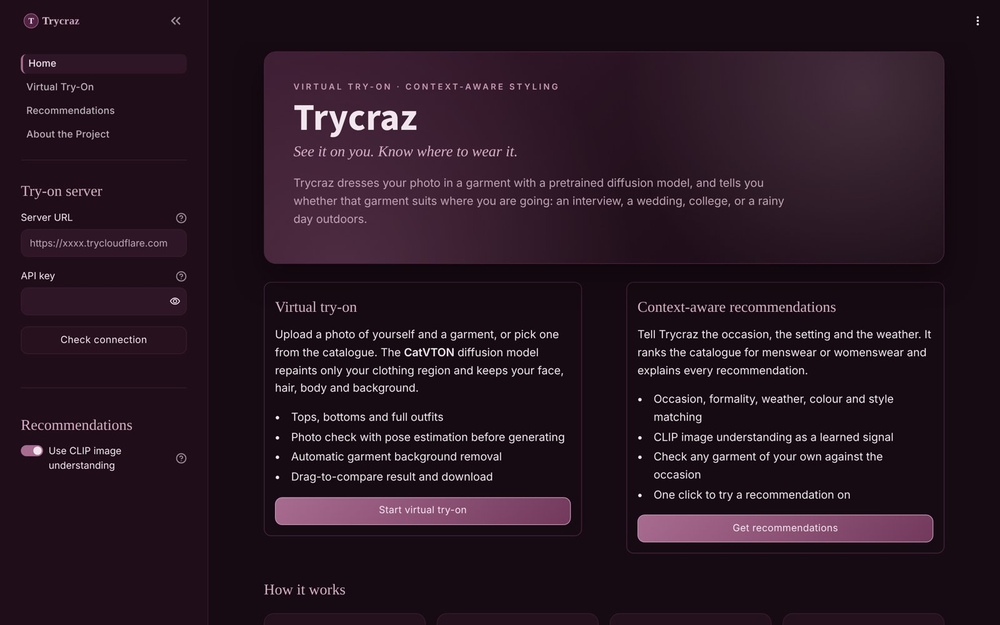
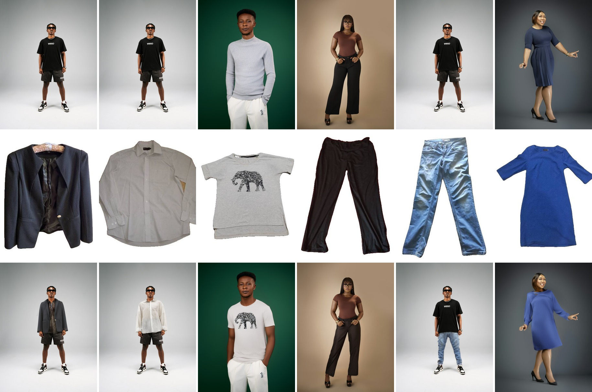
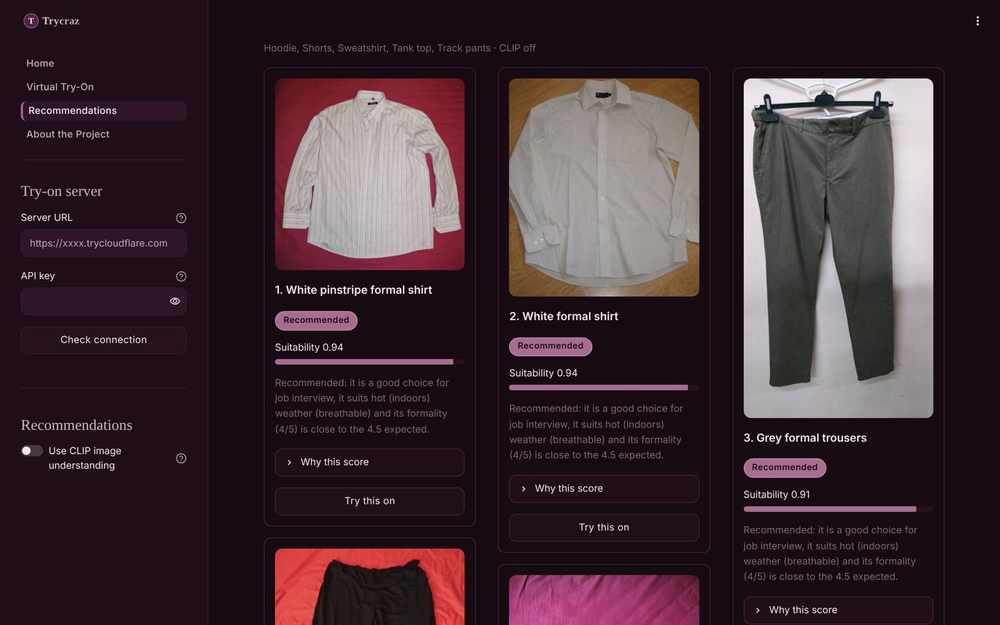
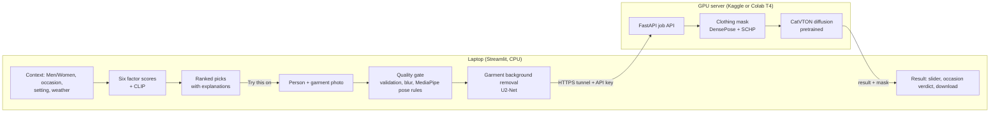

# Trycraz: Virtual Try-On with Context-Aware Clothing Recommendations


-A86C90)


**See it on you. Know where to wear it.**

Trycraz is a B.Tech Computer Vision course project at IIT Jodhpur. It answers two questions about clothes:

1. **How does it look on me?** You upload your photo and a garment photo. The pretrained **CatVTON** diffusion model renders you wearing the garment in about a minute.
2. **Should I wear it there?** You choose Men or Women, the occasion, the setting and the weather. A context-aware recommender ranks a 52-garment catalogue and explains every score. Any recommendation can be tried on with one click.



## Contents

- [Results](#results)
- [How it works](#how-it-works)
- [Quick start](#quick-start)
- [Repository layout](#repository-layout)
- [Testing and evaluation](#testing-and-evaluation)
- [Documentation](#documentation)
- [Limitations](#limitations)
- [Team](#team)
- [Credits and licences](#credits-and-licences)

## Results

All numbers below come from real runs. Details are in the [test report](docs/test_report.md) and the [project report (PDF)](docs/report/Trycraz_Project_Report.pdf).

**Virtual try-on.** CatVTON ran on a free T4 GPU through our pipeline. Rows: the input person, the garment after our background removal, and the result.



| Measure (T4, 30 steps, fp16) | Value |
|---|---|
| Diffusion time | 61.5 to 62.4 s (about 2.1 s per step) |
| Clothing mask (DensePose + SCHP) | 0.94 to 1.36 s |
| Peak GPU memory | 4.89 GB of 15 GB |
| Round trip from the laptop | 69 to 133 s |
| Validation try-ons | 6 of 6 successful (2 of 6 before our two fixes) |

**Recommendations** (12 labelled scenarios, k = 5):

| Configuration | Mean P@5 | Mean nDCG@5 |
|---|---|---|
| Attribute rules only | 0.767 | 0.751 |
| CLIP only | 0.667 | 0.691 |
| **Hybrid (Trycraz)** | **0.833** | **0.830** |



## How it works



- **Try-on (pretrained).** CatVTON is a Stable Diffusion 1.5 inpainting UNet. It places the person and the garment side by side, so its self-attention can copy garment details to the right place without a separate warping network. We use it as published and did not retrain it.
- **Quality gate (ours).** MediaPipe pose landmarks catch photos that usually fail before any GPU time is spent: missing body parts, side or back views, blur, bad lighting, and photos cut off at the hips. We found that last rule by diagnosing a real failure; see the [test report](docs/test_report.md).
- **Background removal (ours, pretrained U²-Net).** CatVTON was trained on product photos on white. Garment photos taken on a bed or a floor are cut out and placed on white first.
- **GPU server (ours).** A small FastAPI job API runs in a free Kaggle or Colab notebook behind a Cloudflare quick tunnel. Jobs and progress polling get around the tunnel's ~100 s request limit.
- **Recommender (ours).** Each garment gets six scores in [0, 1]: occasion, formality, weather, colour, style and CLIP. Their weighted sum ranks the catalogue, and the explanation is built from the same numbers, so it can never contradict the ranking. Clearly wrong items, such as shorts for an interview, are excluded and listed separately.

More detail is in [docs/ARCHITECTURE.md](docs/ARCHITECTURE.md).

## Quick start

You need a Windows, macOS or Linux computer with Python 3.12 for the app, and a free [Kaggle](https://www.kaggle.com) or [Google Colab](https://colab.research.google.com) account for the GPU. The Recommendations page works without the GPU.

**1. Install the app (once)**

**Windows, easiest:** double-click `start_app.bat`. On the first run it creates the Python environment (`.venv`) and installs everything from `requirements.lock.txt`. This takes about 5 to 15 minutes, and then it starts the app. It uses [uv](https://docs.astral.sh/uv/) if you have it; otherwise it needs Python 3.12 from [python.org](https://www.python.org/downloads/).

**Manual install (any system):**

```powershell
git clone https://github.com/CrazAzartto/trycraz-virtual-tryon.git
cd trycraz-virtual-tryon
pip install uv
uv venv .venv --python 3.12
uv pip install --python .venv\Scripts\python.exe -r requirements.lock.txt
.venv\Scripts\python scripts\check_env.py
```

On macOS or Linux, use `.venv/bin/python` instead of `.venv\Scripts\python.exe`. If you downloaded a zip instead of cloning, skip the first two lines and open a terminal in the unzipped folder.

**2. Start the GPU server.** Upload `notebooks/colab_tryon_server.ipynb` to Kaggle (GPU T4, Internet on) or Colab (T4 runtime) and run all cells. The last step prints a **URL** and an **API key**. The [setup guide](docs/SETUP.md) has every click.

**3. Start the app.** On Windows, double-click `start_app.bat` and paste the URL and key, or leave both empty to use only the Recommendations page. Otherwise run:

```bash
.venv/bin/streamlit run app.py
```

Then paste the URL and key into the sidebar and press **Check connection**.

**4. Stop the GPU** when you finish (Kaggle: *Stop session*), so you don't use up your weekly GPU quota.

**Tips for good results:** face the camera with your arms at your sides and your body visible down to at least mid-thigh. Use a plain background and even light. Photograph the whole garment, laid flat or on a hanger.

## Repository layout

| Path | Purpose |
|---|---|
| `app.py`, `views/` | Streamlit entry point and the four pages (Home, Virtual Try-On, Recommendations, About) |
| `ui/` | Theme, shared widgets and session state |
| `virtual_tryon/` | Validation, preprocessing, pose quality gate, background removal, try-on service and backends |
| `tryon_server/` | GPU-side FastAPI server that wraps CatVTON (runs on Kaggle or Colab) |
| `recommendation/` | Knowledge base, context processing, scoring, explanations, CLIP and garment analysis |
| `config/` | `settings.py` (paths and defaults) and `recommendation.yaml` (dress-code knowledge and weights) |
| `common/` | Image helpers and input validation |
| `data/catalogue/` | 52-garment demo catalogue (CC0 images) and its annotations |
| `assets/` | Sample people (Unsplash), a failure example, UI logo and icons |
| `notebooks/` | GPU server notebook (generated by `scripts/build_colab_notebook.py`) |
| `scripts/` | CLI try-on, catalogue builder, annotation tools, environment check |
| `evaluation/` | Recommender evaluation script, labelled scenarios and results |
| `tests/` | pytest suite (166 tests) and a CatVTON compatibility smoke test |
| `docs/` | Setup guide, architecture, design study, test report, project report, figures |

## Testing and evaluation

```powershell
.venv\Scripts\python -m pytest                    # all 166 tests
.venv\Scripts\python -m pytest -m "not slow"      # skip the tests that load MediaPipe / U2-Net
.venv\Scripts\python -m evaluation.rec_eval --catalogue data/catalogue/clothing_catalogue.csv --scenarios evaluation/rec_scenarios.yaml --clip
```

The tests cover input validation, CatVTON-identical cropping, the server API and its error codes, the laptop client against a real local server, the pose rules, recommender behaviour and explanations, the ranking metrics and the app pages. A browser-free mock engine (labelled `MOCK (test only)`) lets the app be tested without a GPU. It is never shown as a try-on result.

## Documentation

| Document | What is in it |
|---|---|
| [docs/SETUP.md](docs/SETUP.md) | Step-by-step installation, GPU server on Kaggle and Colab, troubleshooting |
| [docs/ARCHITECTURE.md](docs/ARCHITECTURE.md) | Components, data flow, server API, recommender formulas |
| [docs/report/Trycraz_Project_Report.pdf](docs/report/Trycraz_Project_Report.pdf) | Full project report (IEEE format); LaTeX source in `docs/report/latex/` |
| [docs/test_report.md](docs/test_report.md) | Every test and real run, including the failure diagnosis |
| [docs/phase1_feasibility.md](docs/phase1_feasibility.md) | Model survey and design decisions |
| [docs/PROGRESS.md](docs/PROGRESS.md) | What is done, what is pending, file log |
| [docs/environment.md](docs/environment.md) | Tested hardware and library versions |

## Limitations

- Try-on quality was judged by eye on 12 real runs. Paired image metrics (SSIM, LPIPS, KID) on VITON-HD have not been computed yet.
- The recommender was evaluated on 12 scenarios labelled by one annotator, so the scores are likely optimistic.
- Catalogue images are only 400 px wide, and there is no traditional Indian wear (kurta, saree) yet.
- The dress-code rules are hand-written and culturally specific. Treat recommendations as suggestions.
- Try-on needs a free cloud GPU, which can disconnect. Each new session spends a few minutes downloading the model.

## Team

| Name | Roll number | Department |
|---|---|---|
| Darshan Prajapati | B23CH1032 | Chemical Engineering |
| Sunny Kumar | B23ME1073 | Mechanical Engineering |

Indian Institute of Technology Jodhpur, Computer Vision course project, 2026.

## Credits and licences

- **Our code:** MIT licence (see [LICENSE](LICENSE)).
- **CatVTON:** Chong et al., *Concatenation Is All You Need for Virtual Try-On with Diffusion Models*, ICLR 2025, [github.com/Zheng-Chong/CatVTON](https://github.com/Zheng-Chong/CatVTON), CC BY-NC-SA 4.0. It is not included in this repository: the notebook downloads it at a pinned commit. Because of this licence, **Trycraz may only be used for non-commercial purposes.**
- **Other pretrained models:** Stable Diffusion 1.5 inpainting (CreativeML OpenRAIL-M), DensePose and Detectron2 (Meta), SCHP (Li et al.), MediaPipe Pose (Google, Apache 2.0), U²-Net (Qin et al., Apache 2.0) via rembg (MIT), CLIP ViT-B/32 (OpenAI, MIT).
- **Images:** catalogue garments are from the [Clothing Dataset](https://github.com/alexeygrigorev/clothing-dataset) by A. Grigorev (CC0); sample people are from Unsplash (Unsplash licence). See the `ATTRIBUTION.md` file in each folder.

**Privacy:** photos are sent only to your own GPU notebook over HTTPS. Results are saved in `outputs/`, which git ignores.
