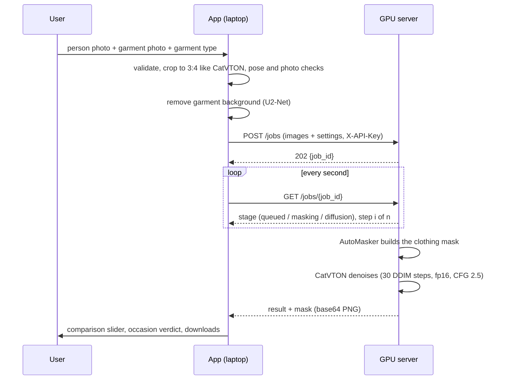
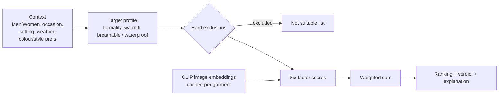

# Architecture

Trycraz is split across two machines because the try-on model (CatVTON, 899 M parameters) does not fit on a laptop GPU:

| Where | What runs there |
|---|---|
| Laptop (CPU) | Streamlit app, input validation, MediaPipe pose quality gate, U²-Net background removal, CLIP, recommender |
| Cloud GPU (Kaggle or Colab, NVIDIA T4) | FastAPI job server, CatVTON with its AutoMasker (DensePose + SCHP) |

The two talk over HTTPS through a Cloudflare quick tunnel and authenticate with an API key that is generated for each session.

## Try-on pipeline

| Step | Module | Notes |
|---|---|---|
| Validation | `common/validation.py` | Format, size (at most 15 MB, 256 to 8000 px), aspect ratio (at most 3:1), EXIF rotation, transparency flattened onto white |
| Preprocessing | `virtual_tryon/preprocessing.py` | Same centre crop as CatVTON's `resize_and_crop` (a unit test checks they match); garments are padded, never cropped |
| Quality gate | `virtual_tryon/quality_check.py` | MediaPipe BlazePose (lite) landmarks and the rules below |
| Background removal | `virtual_tryon/garment_segmentation.py` | U²-Net via rembg; the garment is put on white and cropped |
| Service | `virtual_tryon/service.py` | Runs the steps, calls the backend, saves each run to `outputs/runs/` |
| Backends | `virtual_tryon/backends/` | `remote` (HTTP client, default), `local` (in-process, for a machine with a large GPU), `base` (interface) |
| Server | `tryon_server/server.py`, `jobs.py` | Job queue with a single worker, progress counted by wrapping the scheduler's `step` |
| Engine | `tryon_server/catvton_engine.py` | Loads CatVTON at a pinned commit, fp16, `mix-48k-1024` weights; copies unmasked pixels back (repaint) |

### Quality rules

Rules are checked on the 3:4 crop the model actually sees. Errors are likely to break the try-on, and warnings may degrade it. Neither blocks the user.

| Rule | Threshold | Level |
|---|---|---|
| Required body parts visible (shoulders; plus hips, knees or ankles depending on the garment type) | visibility at least 0.5 | error |
| Photo cut off at the hips | hip line below 85% of the height | error (warning above 75%) |
| Side view | shoulder width / torso length below 0.35 | warning |
| Back view | left shoulder appears to the left of the right one | warning |
| Person too small | visible landmarks span less than 30% of the height | warning |
| Blur | variance of the Laplacian below 35 (at 512 px) | warning |
| Too dark / overexposed | mean luminance below 60 / above 225 | warning |

The hip rule and the blur threshold were calibrated on real runs. The details are in [test_report.md](test_report.md).

## Server API

All endpoints except `/health` need the header `X-API-Key: <key>`.

| Method and path | Request | Response |
|---|---|---|
| `GET /health` | none | engine name, GPU, whether the model is ready |
| `POST /jobs` | multipart form: `person`, `garment` (images), `garment_type` (`upper`, `lower` or `overall`), `steps` (default 30), `guidance` (2.5), `seed` (42), `repaint` (true), optional `mask` | `202 {"job_id": ...}` |
| `GET /jobs/{id}` | none | `status`, `stage`, `step`, `total_steps`, `queue_position`, `elapsed_s`; when done, `result` holds the generated image and mask (base64 PNG), timings and peak GPU memory |

| Error code | Meaning |
|---|---|
| 400 | empty or invalid image |
| 401 | missing or wrong API key |
| 404 | unknown job (the server may have restarted) |
| 413 | image too large |
| 422 | invalid settings |
| 500 | generation failed |
| 503 | queue full |
| 507 | GPU out of memory |

The client turns each code into a plain-language message. The notebook is generated from the files in `tryon_server/` by `scripts/build_colab_notebook.py`, and a test checks that the two are identical.

## Recommender

All dress-code knowledge is in `config/recommendation.yaml`: 9 occasions, 4 weather types, 26 garment types, 16 colour names, the factor weights and the explanation thresholds.

**Score.** S(g, c) = sum over k of w_k * f_k(g, c), with each f_k in [0, 1]:

| Factor | Weight | How it is computed |
|---|---|---|
| Occasion | 0.30 | 1 if the garment is tagged as a primary choice for the occasion, 0.6 if secondary, 0.2 otherwise, 0 for a type that is discouraged for this occasion |
| Formality | 0.20 | max(0, 1 - abs(garment formality - target) / 4), on a 1 to 5 scale; the user can shift the target by up to 1 |
| Weather | 0.20 | 0.7 * max(0, 1 - abs(garment warmth - target) / 3) + 0.3 * (breathable when hot, water resistant in outdoor rain) |
| Colour | 0.10 | the user's colours, otherwise the occasion's palette, otherwise neutral (0.5) |
| Style | 0.05 | the user's styles, otherwise neutral |
| CLIP | 0.15 | average over occasion and weather of p(chosen) / max p, from CLIP ViT-B/32 zero-shot with three prompt templates |

If CLIP is unavailable, its weight is shared among the other factors. Hard exclusions (wrong category, wrong wear line, or a type excluded for the occasion) happen before ranking.

**Explanations.** Each factor returns a positive and a negative phrase. A phrase is used only when the value is at least 0.7 (a reason) or at most 0.3 (a caution). The verdict follows the total score: *Recommended* at 0.70 or more, *A reasonable option* at 0.50 or more, and *Weak match* below that. Because the text comes from the same numbers as the ranking, it cannot contradict it.

**Your own garment.** CLIP guesses the garment type from 26 classes, and k-means (k = 3) in CIELAB names the main colours. Pixels within a colour distance (Delta E) of 18 of the border colour count as background. The estimated garment is then scored like a catalogue item.

## Application

| Page | File | What it does |
|---|---|---|
| Home | `views/home.py` | Overview and links to both features |
| Virtual Try-On | `views/tryon.py` | Photo and garment selection, quality report, generation with progress, comparison slider, downloads, saved results |
| Recommendations | `views/recommend.py` | Men/Women choice, context form, ranked cards, factor breakdown, "Try this on", checking your own garment |
| About the Project | `views/about.py` | Method, what is ours and what is pretrained, limitations, credits |

The theme (berry and plum palette, Inter and Playfair Display fonts) is set in `.streamlit/config.toml` and `ui/theme.py`. Session keys are prefixed with `vto_` to avoid clashes with widget keys.
