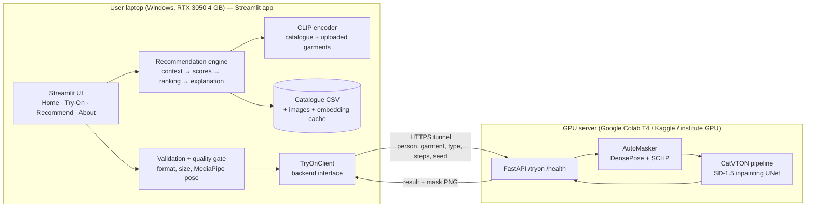

# Phase 1 — Research, Feasibility and Architecture

**Project:** Virtual Try-On of Clothes with Context-Aware Clothing Recommendations
**Authors:** Darshan Prajapati (B23CH1032) and Sunny Kumar (B23ME1073), IIT Jodhpur — Computer Vision course project
**Phase status:** Phase 1 complete (research + design). No code has been run yet; nothing below is a measured result unless marked **[verified]**.

Legend used throughout:

| Tag | Meaning |
|---|---|
| **[verified]** | Checked directly against the source (repository code, README, LICENSE file, or the hardware itself) on 2026-11-08 |
| **[estimate]** | Our own calculation or reasoned estimate — to be measured in later phases |
| **[to test]** | A claim we must confirm experimentally before relying on it |

---

## 1. Understanding of the project

The system answers two questions for a user:

1. **"How will this garment look on me?"** — *image-based virtual try-on.* Given a photo of a person and a photo of a garment, synthesize a new photo of the same person wearing that garment, keeping face, hair, body shape, pose and background unchanged.
2. **"What should I wear for this occasion?"** — *context-aware recommendation.* Given an occasion (interview, wedding, college…), an environment (indoor/outdoor, hot/cold/rainy) and optional preferences (colours, style, formality), rank the garments of a catalogue by suitability and explain each ranking.

The integration closes the loop: **recommend → pick → try on → compare → try the next recommendation**, and in reverse, **upload any garment → judge its suitability for the chosen occasion**.

A plain-language analogy: the recommender is the friend who says *"for an interview, wear the navy blazer, not the hoodie"*; the try-on model is the mirror in the trial room. Existing try-on research builds only the mirror. Our project puts the friend and the mirror in the same room.

### What is ours and what is borrowed (honest scope)

| Component | Who does it |
|---|---|
| Try-on image synthesis (diffusion model) | **Pretrained CatVTON** (Chong et al., ICLR 2025) — we do not train or modify it |
| Clothing-agnostic mask (DensePose + SCHP human parsing) | **CatVTON's bundled AutoMasker** — pretrained models, we call them |
| Input validation, image-quality and pose checks (MediaPipe Pose) | **Ours** |
| Inference server, client, backend abstraction, error handling | **Ours** |
| Context processor, attribute scoring, CLIP semantic scoring, ranking, explanations | **Ours** (CLIP itself is pretrained) |
| Garment analysis of user-uploaded garments (zero-shot CLIP attribute tagging → suitability score, auto-selecting try-on type) | **Ours** |
| Catalogue schema, annotation, demo catalogue | **Ours** |
| Evaluation protocol, scenario set, ablations | **Ours** |
| Streamlit application | **Ours** |

We will not claim a new try-on architecture. The contribution is a **system-level integration plus a context-aware recommendation method** (Section 11 of the brief; details in §5.4 below).

---

## 2. Technical breakdown of the two modules

### 2.1 Virtual try-on module

How the selected model (CatVTON) actually works **[verified from `model/pipeline.py` and `model/cloth_masker.py`]**:

| Step | What happens | Implemented by |
|---|---|---|
| 1. Preprocessing | Person image resized + centre-cropped to 768×1024 (3:4); garment image resized + padded to 768×1024 | CatVTON utils, wrapped by us (we add EXIF-orientation fix, format/size validation) |
| 2. Pose / body-surface estimation | **DensePose** (Detectron2, R50-FPN) maps every body pixel to a body part (torso, arms, hands, legs…) | Pretrained, inside AutoMasker |
| 3. Human parsing | **SCHP** run twice (LIP and ATR label sets) segments face, hair, upper-clothes, pants, dress, shoes, accessories… | Pretrained, inside AutoMasker |
| 4. Clothing-agnostic mask | Rule-based fusion: mask = region of the current garment type (upper / lower / overall), convex-hull expanded, blurred and dilated, while *protecting* face, hands, feet, hair and clothes of other categories | CatVTON code (deterministic image processing, no learning) |
| 5. Garment representation | Garment image encoded by the SD VAE into a latent (no separate garment encoder, no text encoder, no CLIP image encoder) | Pretrained VAE |
| 6. Warping | **No explicit warping** (no TPS / flow). Spatial alignment is learned implicitly by self-attention | — |
| 7. Conditioning | Person latent (masked) and garment latent are **concatenated side by side along the height axis** and passed through one SD-1.5 inpainting UNet. Cross-attention is removed; only self-attention layers (49.57 M parameters) were fine-tuned. Self-attention lets every person-pixel "look at" every garment-pixel — this replaces warping | Pretrained CatVTON weights |
| 8. Synthesis | DDIM denoising (default 50 steps, classifier-free guidance 2.5) | Pretrained |
| 9. Post-processing | Decode latent, crop away the garment half, optional NSFW safety-checker, (optional) repaint unmasked region with original pixels | CatVTON + ours (comparison view, download) |

Analogy for step 7: older methods cut out the shirt and physically stretched it like a rubber sheet over the body (warping), which tore on complex poses. CatVTON instead puts the person and the shirt photo side by side on one canvas and asks a painter who has seen tens of thousands of examples to repaint the person's torso while constantly glancing at the shirt.

**Garment types offered by the model code [verified]:** `upper`, `lower`, `overall` (dresses / full outfits). Which of these actually work well on our photos is **[to test]** — the brief rightly says we must not claim a category until tested.

### 2.2 Context-aware recommendation module

Approach chosen: **hybrid knowledge-based + content-based ranking** (scoring with explanations), with **CLIP image–text similarity** as one learned signal. Reasoning in §5.

```
context (occasion, environment, prefs)
        │
        ▼
 ContextProcessor ──► target profile: target formality, allowed/blocked styles,
        │             warmth range, rain need, colour prefs, CLIP text prompt
        ▼
 Catalogue (CSV + images + cached CLIP embeddings)
        │
        ▼
 Hard filters (category, optional menswear/womenswear filter, explicit exclusions)
        │
        ▼
 Feature scores per garment  f_occasion, f_formality, f_weather, f_colour, f_style, f_clip  ∈ [0,1]
        │
        ▼
 Weighted sum  S = Σ w_k f_k   (weights in config, tunable, ablatable)
        │
        ▼
 Ranked list + explanation built from the top contributing factors
```

---

## 3. Comparison of virtual try-on models

All license, base-model and preprocessing facts are **[verified]** from the official repositories / model cards listed in Sources. VRAM is only quoted where the authors state it; anything else is an **[estimate]** from model size.

| Model (venue) | Core idea | Output res. | Garments | Preprocessing needed at inference | Weights | License | Hardware | Fit for us |
|---|---|---|---|---|---|---|---|---|
| VITON (CVPR'18) | Coarse result + shape-context TPS warp + refinement | 256×192 | Upper | Pose + parsing | Old TF code; dataset no longer officially distributed | Research | Light | ✗ obsolete, low res |
| CP-VTON (ECCV'18) | Learnable TPS warp (GMM) + try-on module | 256×192 | Upper | Pose + parsing | Community | Research | Light | ✗ low res, warping artefacts |
| ACGPN (CVPR'20) | Predict semantic layout, then warp + inpaint | 256×192 | Upper | Pose + parsing | Available | Research | Light | ✗ low res |
| VITON-HD (CVPR'21) | ALIAS normalisation for misalignment, GAN | 1024×768 | Upper (women) | OpenPose + human parsing + agnostic map | Google Drive | CC BY-NC 4.0 | Moderate (GAN) | △ old PyTorch stack, heavy custom preprocessing |
| HR-VITON (ECCV'22) | Joint warping + segmentation condition generator | 1024×768 dataset | Upper (women) | OpenPose + DensePose + parsing | Google Drive | CC BY-NC 4.0 | Moderate; PyTorch 1.8.2 + CUDA 11.1 tested | △ dated environment, preprocessing heavy |
| StableVITON (CVPR'24) | Latent diffusion (Paint-by-Example) + zero cross-attention | VITON-HD | Upper (women) | DensePose + agnostic mask (SAM suggested for wild images) | SharePoint link | CC BY-NC-SA 4.0 | Not stated | △ no automatic masking for user photos |
| IDM-VTON (ECCV'24) | SDXL inpainting TryonNet + SDXL GarmentNet + IP-Adapter | 1024×768 | Upper (VITON-HD); upper/lower/dress (DressCode) | DensePose + OpenPose + human parsing (all in its demo) | HF Hub | CC BY-NC-SA 4.0 | Not stated; two SDXL-scale UNets ≈ 10 GB of fp16 weights **[estimate]** | ✗ too heavy for T4-class GPUs without tricks |
| OOTDiffusion (AAAI'25) | Outfitting UNet + denoising UNet (SD-1.5) with outfit fusion | VITON-HD / DressCode | Half-body and full-body checkpoints | OpenPose + human parsing | HF Hub | CC BY-NC-SA 4.0 | Authors tested only on Linux | △ two UNets, Linux-only |
| **CatVTON (ICLR'25)** | **Single SD-1.5 inpainting UNet, person‖garment spatial concatenation, no text/image encoders, only self-attention trained** | **1024×768** | **upper / lower / overall** | **Bundled AutoMasker (DensePose + SCHP) — automatic** | **HF Hub `zhengchong/CatVTON`** | **CC BY-NC-SA 4.0** | **Authors: < 8 GB VRAM at 1024×768 (bf16); 899.06 M params total** | **✓ selected** |
| Leffa (CVPR'25) | Flow-field learning inside attention to reduce detail distortion; generative UNet + reference UNet | VITON-HD / DressCode | upper / lower / dress | DensePose + SCHP + OpenPose | HF Hub `franciszzj/Leffa` | MIT (code) | Not stated; ~6 s/image on A100 (authors) | ✓ secondary / comparison model |

### Scoring against the brief's 10 criteria (CatVTON vs. the two strongest alternatives)

| Criterion | CatVTON | Leffa | IDM-VTON |
|---|---|---|---|
| 1. Garment preservation | Good (paper reports SOTA-level on VITON-HD/DressCode) | Designed specifically to reduce texture distortion | Very good |
| 2. Realistic fitting | Good; no warping stage to fail | Good | Very good |
| 3. Identity preservation | Unmasked pixels are kept (inpainting) | Same (inpainting) | Same |
| 4. Categories | upper / lower / overall | upper / lower / dress | upper (+DressCode variants) |
| 5. Resolution | 1024×768 | 1024×768 | 1024×768 |
| 6. Hardware | **Lowest of the diffusion models** (1 UNet, < 8 GB stated) | 2 UNets **[estimate: more VRAM than CatVTON]** | Highest |
| 7. Install complexity | Medium (pip; Linux) | Medium (pip; Linux) | High (conda env, IP-Adapter, several checkpoints) |
| 8. Weights | One HF repo, auto-download | One HF repo (also downloads SDXL for pose transfer unless trimmed) | Several sources |
| 9. License | CC BY-NC-SA 4.0 — academic use fine | MIT code; checkpoints trained on non-commercial datasets | CC BY-NC-SA 4.0 |
| 10. Python integration | Clean `CatVTONPipeline(...)` + `AutoMasker(...)` classes | Clean `LeffaModel` / `LeffaInference` classes | Gradio-script oriented |

### Final selection

**Primary model: CatVTON** — the best trade-off of quality, memory, automatic masking for arbitrary user photos, and integration simplicity. It is also the easiest to *explain in a viva*: one UNet, one idea (concatenate and let self-attention do the alignment).

**Secondary model (stretch goal): Leffa** — run on the same evaluation subset to produce a genuine two-model comparison table for the report. Our backend abstraction makes this a plug-in, not a rewrite.

**Licensing consequence:** CatVTON's CC BY-NC-SA 4.0 means non-commercial use only and share-alike for derivatives of *their* code. We will **not vendor CatVTON source into our GitHub repo**; the GPU server clones the pinned upstream commit at runtime. Our own code can carry its own license (MIT suggested), with a clear notice that running it pulls in CC BY-NC-SA components.

Pinned upstream commits (checked 2026-11-08):
- CatVTON `7818397f25613beedb3d861a34769f607cfcf3b1` (2025-12-16)
- Leffa `05a259104b6927607776c7edb3e86b75406f20aa` (2025-09-12)

---

## 4. Proposed system architecture



Key design decisions:

1. **Inference runs behind an HTTP interface.** The UI only talks to a `TryOnBackend` interface with implementations `RemoteBackend` (Colab/Kaggle/institute GPU via tunnel URL) and `LocalBackend` (same code in-process, for anyone with an ≥ 8 GB Linux GPU). Changing GPU provider changes one setting, not the UI or the recommender (brief §14).
2. **The recommender never depends on try-on.** It runs fully on the laptop CPU, so the recommendation page works even when no GPU server is up (brief §6).
3. **Model-agnostic server contract.** The same `/tryon` contract can be served by a CatVTON or a Leffa server — this is what makes the two-model comparison cheap.
4. **Demo resilience.** Every real try-on result is saved with its inputs and parameters. The app has a clearly-labelled "saved results" gallery so a viva demo survives a Colab outage — and it is labelled as cached, never passed off as live.

---

## 5. Recommendation methodology (why this approach)

| Option | Verdict |
|---|---|
| Pure rule-based | Transparent, but brittle and cannot handle user-uploaded garments with no metadata |
| Collaborative filtering | ✗ needs user–item interaction history we don't have |
| Train an ML classifier | ✗ needs a labelled occasion dataset we don't have; would be fabricated |
| CLIP-only zero-shot | Handles any image, but unexplainable and noisy on fine distinctions |
| **Hybrid: attribute scoring + CLIP similarity** | **✓ explainable, works on catalogue *and* uploaded garments, measurable via ablation** |

### 5.1 Scoring

For garment *g* and context *c*:

S(g, c) = w_occ·f_occ + w_form·f_form + w_wx·f_weather + w_col·f_colour + w_sty·f_style + w_clip·f_clip

- f_occ — 1 if *c.occasion* is among the garment's primary occasions, 0.5 if secondary, 0 otherwise.
- f_form — 1 − |formality(g) − target_formality(c)| / 4 (formality on a 1–5 scale; target comes from occasion, shifted by the user's formality preference).
- f_weather — combines warmth level vs. temperature context, breathability for hot weather, water resistance for rain, layering for cold.
- f_colour, f_style — preference matches (neutral 0.5 when the user gives no preference, so absent preferences don't punish anything).
- f_clip — cosine similarity between the garment's CLIP image embedding and a context prompt (e.g. *"a photo of formal attire suitable for a job interview indoors"*), min–max normalised over the candidate set.
- Hard constraints remove garments before scoring (requested category, optional menswear/womenswear filter, explicit exclusions such as athletic shorts for an interview).

Weights live in `config/`, not in code, so ablations are a config change.

### 5.2 Explanations

Each explanation is generated from the factors that actually contributed most to that garment's score, e.g. *"Recommended because it is a formal blazer (formality 5/5, matches 'Interview'), suits indoor use, and matches your preferred colour navy."* A unit test checks that every claim in an explanation corresponds to a factor above threshold — so explanations cannot drift from the scores.

### 5.3 Uploaded-garment analysis

When the user uploads their own garment, CLIP zero-shot classification estimates its type (→ which CatVTON mask type to use: upper / lower / overall), formality and style. The same scoring function then gives a **suitability score + explanation for the chosen occasion**. This is clearly labelled as an automatic estimate.

### 5.4 What is genuinely new vs. integration

- **Integration of existing methods:** CatVTON, DensePose, SCHP, CLIP, MediaPipe — all pretrained, all cited.
- **Our contribution:** (a) a context model that maps occasion + environment + preferences to a target garment profile; (b) a hybrid explainable scoring function combining symbolic attributes with CLIP semantics, evaluated by ablation; (c) the closed loop in which recommendations feed try-on and uploaded garments feed back into suitability scoring (including automatic choice of the try-on mask type); (d) an input-quality gate that tells users *before* a 30-second GPU job whether their photo is likely to fail.

---

## 6. Datasets and resources

| Resource | Contents | Resolution | Annotations | License / access | Needed? |
|---|---|---|---|---|---|
| VITON (Han et al. 2018) | Person–top pairs | 256×192 | Pose, parsing | Original dataset no longer officially distributed | ✗ superseded |
| **VITON-HD** | 11,647 train + 2,032 test frontal women / top pairs **[verified]** | 1024×768 | Cloth masks, parsing, pose, agnostic maps, DensePose (in the preprocessed release) | **CC BY-NC 4.0**, research only, Google Drive **[verified]** | **✓ test split only:** paired evaluation (SSIM/LPIPS/KID) and a few catalogue garments with attribution |
| Dress Code | 53,792 garments, 107,584 images; upper, lower, dresses **[verified]** | 1024×768 | 18 OpenPose keypoints, skeletons, SCHP label maps, DensePose | Google Form + license agreement **[verified]** | Optional — only if we want lower-body/dress paired metrics; requires signed request |
| CatVTON weights (`zhengchong/CatVTON`) | Self-attention weights (`mix-48k-1024`) + DensePose + SCHP checkpoints | — | — | CC BY-NC-SA 4.0 | ✓ |
| SD-1.5 inpainting base | UNet, scheduler (CatVTON uses the mirror `booksforcharlie/stable-diffusion-inpainting` because the original repo was removed) **[verified in app.py]** + `stabilityai/sd-vae-ft-mse` VAE | — | — | CreativeML OpenRAIL-M | ✓ |
| CLIP ViT-B/32 (`openai/clip-vit-base-patch32`) or FashionCLIP | Image–text embeddings | 224×224 | — | MIT | ✓ (we will compare both on our scenario set) |
| MediaPipe Pose | 33 body landmarks, CPU real-time | — | — | Apache 2.0 | ✓ quality gate |

**Demo catalogue (ours, clearly labelled as a sample, not a research dataset):** ~40–60 garments, hand-annotated by us with the schema below. Sources, in order of preference:

1. **Garments we photograph ourselves** (own/friends' shirts, blazers, kurtas, jackets, t-shirts) on a plain background — fully legal, and gives the catalogue Indian occasions (wedding, festival) that VITON-HD lacks entirely.
2. **VITON-HD test garments** — CC BY-NC 4.0 allows non-commercial redistribution with credit; we use a small subset with an `ATTRIBUTION.md`.
3. Images under explicit free licenses (Pexels/Unsplash/CC0) — license recorded per image.

We will **not** commit retailer-scraped product images (CatVTON's own demo examples appear to be retailer product shots, so we won't redistribute those either).

Catalogue schema: `id, name, image_path, tryon_type (upper|lower|overall), garment_type, category, formality (1–5), occasions_primary, occasions_secondary, warmth (1–5), breathable, water_resistant, colours, pattern, style, wear_line (menswear|womenswear|unisex, optional), material, source, license, tryon_tested (yes|no|failed)`.

**User photos:** never committed to Git, never stored beyond the session's `outputs/` folder (git-ignored). They do travel to the GPU server over an HTTPS tunnel — the About page will say so.

---

## 7. Hardware and computational requirements

### 7.1 Your laptop **[verified 2026-11-08]**

| Item | Value | Implication |
|---|---|---|
| OS | Windows 11 Home (build 26300) | CatVTON's README says Windows is not supported; its vendored detectron2 binary is `_C.cpython-39-x86_64-linux-gnu.so` (Linux, Python 3.9) **[verified]** |
| CPU | Intel i5-12450H, 8 cores / 12 threads | Fine for UI, recommender, CLIP, MediaPipe |
| RAM | 7.6 GB total, **1.2 GB free** at check time | Tight. Close browsers/IDEs during demos |
| GPU | **RTX 3050 Laptop, 4 GB VRAM**, driver 617.42 | Below CatVTON's stated < 8 GB figure for 1024×768 |
| Disk | D: 31.7 GB free, C: 103.5 GB free | Enough for the venv and CLIP (~1 GB); the try-on weights stay in the cloud |
| Python | 3.12.10 (via `py -3.12`); also a 3.15 install; `uv` available | We'll use a project venv on 3.12 (MediaPipe / torch wheels exist for 3.12; 3.15 is too new) |
| Git | 2.56 | ✓ |

**Verdict: local try-on inference is not realistic.** The weights alone are ~1.8 GB in fp16 **[estimate: 899 M params × 2 bytes]**, plus activations for a 1024×1536 concatenated canvas with classifier-free guidance (batch of 2), plus DensePose and two SCHP networks — beyond 4 GB VRAM, and the 7.6 GB system RAM leaves no room for CPU offload of an fp32 checkpoint load. A 512×384 local mode might squeeze in; it is **[to test]** and not in the plan's critical path.

### 7.2 Cloud GPU options

| Option | GPU | Notes |
|---|---|---|
| **Google Colab (free)** | Usually a T4, 16 GB | Primary. T4 has no fast bf16 → use **fp16**. Availability and session length are not guaranteed on the free tier |
| Kaggle Notebooks | T4 / P100 | Backup with a weekly free GPU quota |
| IIT Jodhpur GPU server / lab machine | — | Best for the viva if you can get access — stable, no tunnel URL changes |
| HF Space `zhengchong/CatVTON` | ZeroGPU | **✗ not relied upon — the Space showed "Runtime error" when checked [verified]** |

### 7.3 Sizes and speed **[estimates, to be measured in Phase 3]**

- Downloads on the GPU server: SD-1.5 inpainting UNet (fp32 safetensors ≈ 3.4 GB), VAE ≈ 0.3 GB, CatVTON attention + DensePose + SCHP ≈ 1 GB, safety checker ≈ 1.2 GB → **≈ 6 GB** per fresh Colab session (a few minutes).
- Inference on T4 fp16, 1024×768, 50 steps: expected tens of seconds. We will measure and report the real number, and offer a 30-step fast mode.
- Laptop: CLIP ViT-B/32 ≈ 0.6 GB on CPU; catalogue embeddings computed once and cached; a context query takes well under a second.

---

## 8. Implementation plan

| Phase | Deliverable | Done when |
|---|---|---|
| 2 — Setup | Folder structure, `.venv` (Python 3.12), requirements, git repo, Colab notebook skeleton | `pytest` runs (empty) and `streamlit run app.py` opens a blank Home page |
| 3 — Try-on | FastAPI server wrapping CatVTON on Colab; tunnel; `RemoteBackend`; validation + MediaPipe quality gate | **First real try-on result** generated from the laptop UI; error handling tested on bad inputs; per-category test sheet filled in |
| 4 — Recommender | Catalogue (≥ 40 items, photos + metadata), context processor, scoring, CLIP, explanations, uploaded-garment analysis | Unit tests pass; scenario table shows ranking changes with context |
| 5 — Integration | Four-page Streamlit app, "Try this on" from recommendations, comparison slider, download, saved-results gallery | Full workflow works end-to-end on a fresh photo |
| 6 — Evaluation | Paired VITON-HD subset metrics (SSIM, LPIPS, KID, FID with caveat), human rating sheet, recommender P@5 / nDCG@5 + ablations, optional Leffa comparison | `docs/test_report.md` filled with real numbers only |
| 7 — Deliverables | README, report, diagrams, slides, viva Q&A | — |

### 8.1 Evaluation design (what is genuinely measurable)

| Metric | Needs ground truth? | Where we can use it |
|---|---|---|
| SSIM, LPIPS | **Yes — paired** (the person actually wearing that garment) | VITON-HD test pairs only, never on arbitrary user photos |
| FID, KID | No (distribution-level, unpaired) | VITON-HD test subset; FID is biased with a few hundred images, so **KID is the primary number** and FID gets a caveat |
| Inception Score | — | ✗ not meaningful for try-on (ImageNet-class diversity says nothing about garment fidelity) |
| Human rating (1–5: garment fidelity, realism, identity, artefacts) | No | Our own photos; 3+ raters; mean ± std |
| CLIP garment-similarity (garment crop vs. source garment) | No | Supplementary, clearly labelled |
| Precision@5, nDCG@5 | Relevance labels | Recommender: scenarios labelled **before** running the engine, to avoid self-confirmation |
| Ablation (rules only / CLIP only / hybrid) | Same labels | Shows CLIP's contribution honestly — even if it turns out small |
| Rank sensitivity (Kendall τ between contexts) | No | Shows ranking actually changes with context |

---

## 9. Minimum viable version (complete this first)

1. Colab notebook starts a CatVTON server and prints a tunnel URL.
2. Streamlit Try-On page: upload person + garment → choose upper/lower/overall → real result → side-by-side comparison → download.
3. Catalogue of ~20 garments with metadata; rule-based scoring (no CLIP yet) with explanations.
4. "Try this on" button on each recommendation.
5. Basic validation and readable error messages.

Everything else (CLIP, uploaded-garment analysis, MediaPipe gate, Leffa comparison, outfit try-on of top + bottom in two passes) builds on this.

---

## 10. Main technical risks

| Risk | Likelihood | Mitigation |
|---|---|---|
| Vendored detectron2 `_C` binary is built for Python 3.9; Colab ships a newer Python | Medium | The `deform_conv` import of `_C` is wrapped in a fallback **[verified]**, so DensePose R50 may work without it **[to test]**. If not: create a Python 3.9 env on Colab with `uv`, or build detectron2 from source |
| `diffusers` is installed from git HEAD in CatVTON's requirements | Medium | Pin a specific diffusers release that works and record it |
| Colab GPU unavailable / session dies / tunnel URL changes | High on demo day | Kaggle backup, institute GPU if possible, URL set from the UI, labelled saved-results gallery |
| Out-of-distribution garments (kurtas, sarees, long ethnic wear) | High | Test explicitly, document honestly; sarees likely unsupported (draping isn't a single garment layer) |
| Training data is mostly frontal studio photos | High | Quality gate + user guidance (front-facing, arms not crossing torso, plain background, good light) |
| Hands, long hair, accessories crossing the garment → artefacts | Medium | Protected-area masking is built in; document failure cases in the report — failure analysis earns marks |
| 7.6 GB laptop RAM | Medium | Keep heavy models off the laptop; CLIP-B/32 only |
| Non-commercial licenses | Certain | Academic use only; stated in README |
| Privacy of user photos | — | Git-ignored outputs, no persistent storage, disclosure on About page |
| NSFW safety checker blacks out some legitimate outputs | Low | Keep it on (public-facing demo); log when it fires |

---

## 11. Finalised technology stack

| Layer | Choice |
|---|---|
| Laptop runtime | Python 3.12, project `.venv` |
| UI | Streamlit (multipage via `st.navigation`), `streamlit-image-comparison` slider |
| Image handling | Pillow, OpenCV, NumPy |
| Quality gate | MediaPipe Pose |
| Recommender | pandas, PyYAML config, `transformers` CLIP (CPU torch) |
| Client | `requests` |
| GPU server | Colab / Kaggle, PyTorch (fp16), CatVTON @ pinned commit, `diffusers` (pinned), FastAPI + uvicorn, Cloudflare quick tunnel (`cloudflared`, no account needed) |
| Evaluation | `torchmetrics` (SSIM, LPIPS), `clean-fid` (FID/KID) — the same libraries CatVTON's own `eval.py` uses **[verified]** |
| Testing | pytest |
| Docs | Markdown + Mermaid (renders on GitHub) |

## 12. Finalised project structure

```
Project/                              ← this folder = the Git repository root
├── app.py                            Streamlit entry point (navigation only)
├── views/                            home.py, tryon.py, recommend.py, about.py
├── config/
│   ├── settings.py                   paths, server URL, defaults
│   └── recommendation.yaml           weights, occasion → formality map, rules
├── virtual_tryon/
│   ├── backends/                     base.py (interface), remote.py, local.py
│   ├── preprocessing.py              EXIF fix, resize/crop, garment padding
│   ├── quality_check.py              MediaPipe pose / framing checks
│   ├── postprocessing.py             comparison image, metadata, saving
│   └── service.py                    validate → call backend → save
├── tryon_server/                     runs on the GPU machine, not the laptop
│   ├── server.py                     FastAPI: /health, /tryon
│   ├── catvton_engine.py             wraps CatVTONPipeline + AutoMasker
│   └── requirements-server.txt
├── notebooks/
│   ├── colab_tryon_server.ipynb      one-click server start
│   └── evaluation_vitonhd.ipynb      paired metrics on the GPU
├── recommendation/
│   ├── catalogue.py                  load + validate CSV
│   ├── context_processor.py          context → target profile
│   ├── scoring.py                    f_occ, f_form, f_weather, f_colour, f_style
│   ├── clip_encoder.py               CLIP embeddings + cache
│   ├── garment_analyzer.py           zero-shot tagging of uploaded garments
│   ├── recommendation_engine.py      filter → score → rank
│   └── explanations.py
├── common/                           image_utils.py, validation.py  (renamed from utils/ in Phase 3: name clash with CatVTON's utils.py)
├── data/catalogue/                   clothing_catalogue.csv, images/, ATTRIBUTION.md
├── evaluation/                       tryon_metrics.py, rec_scenarios.yaml, rec_eval.py, results/
├── tests/                            unit + integration tests
├── docs/                             phase1_feasibility.md, architecture.md, methodology.md, test_report.md, PROGRESS.md
├── report/  presentation/  viva/     final deliverables
├── outputs/                          generated images (git-ignored)
├── requirements.txt  requirements-dev.txt  .gitignore  README.md  LICENSE
```

---

## Sources

- CatVTON repository and README — https://github.com/Zheng-Chong/CatVTON (code inspected at commit `7818397`)
- CatVTON project page — https://zheng-chong.github.io/CatVTON
- CatVTON weights — https://huggingface.co/zhengchong/CatVTON
- CatVTON HF Space status — https://huggingface.co/spaces/zhengchong/CatVTON/discussions/1
- Leffa model card — https://huggingface.co/franciszzj/Leffa (code inspected at commit `05a2591`)
- IDM-VTON — https://github.com/yisol/IDM-VTON
- OOTDiffusion — https://huggingface.co/levihsu/OOTDiffusion
- StableVITON — https://huggingface.co/rlawjdghek/StableVITON
- HR-VITON — https://github.com/sangyun884/HR-VITON
- VITON-HD — https://github.com/shadow2496/VITON-HD
- Dress Code — https://aimagelab-legacy.ing.unimore.it/imagelab/page.asp?IdPage=47 ; paper: https://openaccess.thecvf.com/content/CVPR2022W/CVFAD/html/Morelli_Dress_Code_High-Resolution_Multi-Category_Virtual_Try-On_CVPRW_2022_paper.html

Full bibliographic references (authors, venues) will be compiled and checked in Phase 7 for the report.
